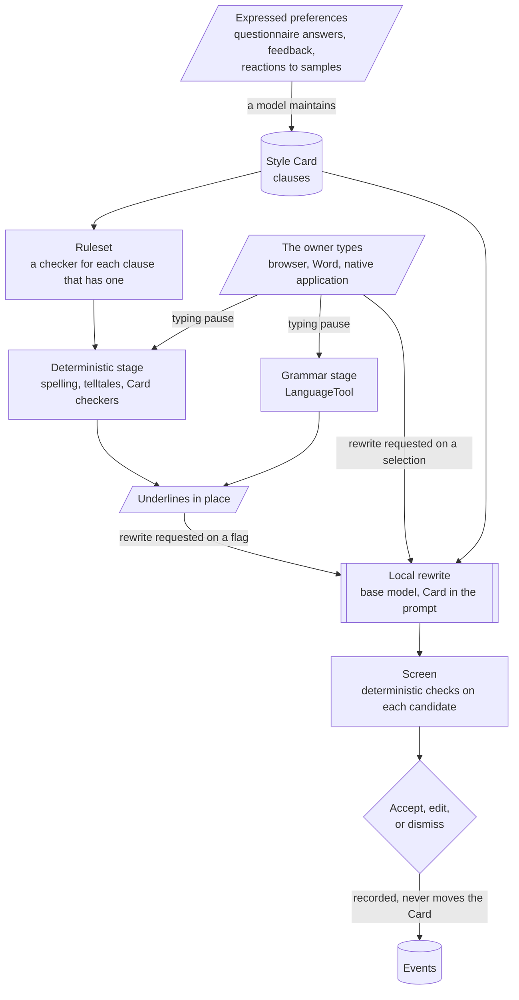
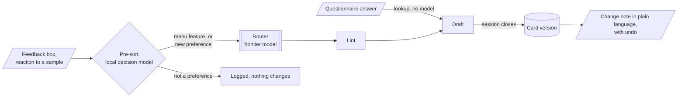
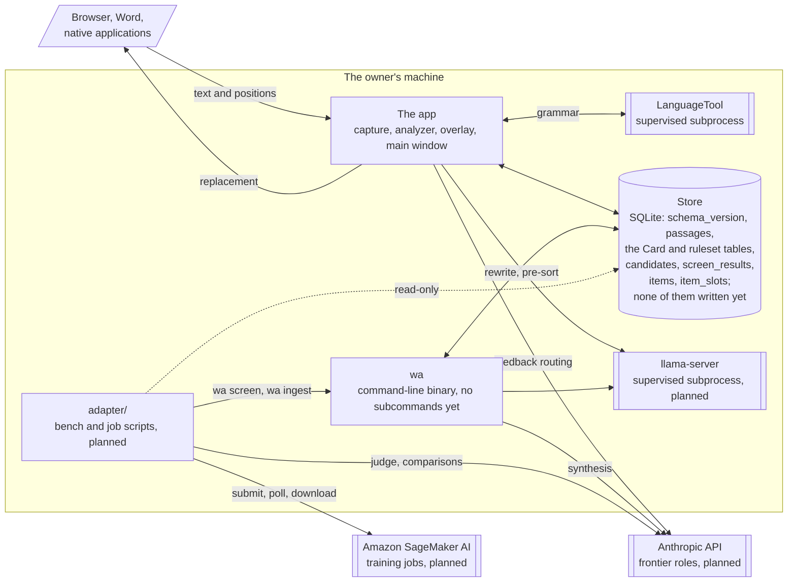

# Writing Assistant

A Windows writing tool built for one person, its owner. It checks spelling, grammar, and style as
the owner types, across the browser, Microsoft Word, and native desktop applications.

The tool coaches toward a declared voice. The voice is held in a Style Card: a list of clauses
that a model maintains from the preferences the owner expresses. The tool flags text that drifts
from the Card's clauses, rewrites passages on request with a local model, and underlines phrasing
that reads as LLM-generated. The owner's present habits are counted and are never a target.

> **Status:** early development. No released build exists. Capture, spelling, grammar, telltale
> underlines, and the overlay run today from a local build. A component that does not exist yet
> is marked planned, with the number of the phase that builds it.

## How it works



The path from typing to underlines runs today, without the Card's checkers. The Card, the ruleset,
the rewrite, the screen, and the event record are planned, and the sections below give the phase
for each.

Two kinds of input are kept apart. An expressed preference is a questionnaire answer, a reaction
to a sample, or free-prose feedback, and it is the only thing that changes the Card. Measured
behaviour is a pick between candidates, an edit of a candidate, or a dismissal. It is recorded and
never moves the Card.

### Terms

| Term | Meaning |
|---|---|
| Style Card | The declared voice: clauses a model maintains from the owner's expressed preferences. The only target |
| Clause | One behaviour, stated so that it can be inverted, with a register scope |
| Twin | A clause's negation, written by a model once the clause exists |
| Checker | An executable test of one clause: a matcher, a unit, and a band |
| Ruleset | The versioned set of checkers |
| Residual | What the Card asks for that no checker expresses: a clause with no checker |
| Candidate | A model's rewrite of a passage |
| Screen | The deterministic checks every candidate passes before it is shown |
| Telltale | A catalogued phrasing that marks text as LLM-generated |
| Habit ledger | Daily counts of clause violations in the owner's typing, shown to the owner and never written to the Card. Planned, Phase 9 |

## Checking

Checking keys to the typing pause. A recheck fires once the document has sat unchanged for
500 ms, and it covers the sentences that changed. No stage runs per keystroke: a flag on a
half-typed word is noise.

| Stage | Work | State |
|---|---|---|
| Deterministic | Spelling, the telltale catalogue, and the Card's checkers. Publishes first | Spelling and telltales run today. Card checkers: planned, Phase 3 |
| Grammar | LanguageTool on the same sentences. Publishes second, with suppression applied | Runs today |
| Rewrite | On request only: the local base model with the Card in its prompt, each candidate screened before it is shown | Planned, Phase 4 |

Neither checking stage calls a model or the network. LanguageTool is a subprocess on the same
machine, reached over the loopback interface. The rewrite is local as well, and it runs only when
the owner asks for one.

Today both stages publish together at the end of a recheck, and the analyzer finds a change by
polling the document every 200 ms. Separate publishes are planned for Phase 1, so that spelling
and telltale flags stop waiting on LanguageTool. An event-driven trigger is planned for Phase 2:
the capture backend's text-changed event marks the document as changed, and a slow safety poll
covers controls that never raise the event.

Flags are cached per sentence by hash, which limits a recheck to the sentences that changed. One
source failing degrades that source and never ends checking: with LanguageTool down, spelling and
telltale flags continue.

### Severity and suppression

Spelling, grammar, and content-preservation flags are hard. Style and telltale flags are soft.
Suppression runs on each sentence's flags once every source has checked it, in four steps, in
this order:

1. Each flag's span is located within its sentence. A flag anchored on other text is kept and
   takes no part in the later steps, since suppression fires only on a confirmed overlap.
2. A hard flag suppresses every soft flag whose span shares at least one code unit with its own,
   whatever the two origins. Two hard flags both stand, and two spans that meet end to start
   share no code unit.
3. The telltales left standing collapse. Each connected group of overlapping telltales, whether
   identical, nested as `is a testament to` and `testament to` are, or partly overlapping,
   becomes one flag. Its span runs from the earliest start in the group to the latest end, it
   carries the message of the widest match, and its detail lists every pattern id in the group.
4. A telltale on exactly a style flag's span is dropped, and its pattern ids are added to the
   style flag's detail. A style flag and a telltale on unequal overlapping spans both stand.

Hard flags act before the collapse, so a hard flag drops only the telltales on its own span: a
telltale that overlaps a dropped one, and not the hard flag, still stands. No source raises a
style flag until a ruleset holds a checker, so today the model shows on telltales: a spelling or
grammar flag suppresses one, and overlapping ones merge into one underline.

### The rule layer

A checker is a Style Card clause made mechanical: the clause's id and a rule. The rule is a
matcher, a unit, and a band, and it declares the form modes it runs in, prose or fragment, and a
register scope, which is every register when unset. The engine holds a checker as data with every
part in the table, and evaluates every matcher and band but the LanguageTool rule id, which the
grammar stage evaluates (planned, Phase 1). Nothing runs a checker yet. Planned for Phase 1: the
analyzer passes that run checkers, and a rule for each telltale pattern.

| Part | Values |
|---|---|
| Matcher | Phrase list, regex, LanguageTool rule id, spelling variant, word count |
| Unit | Span, sentence, paragraph, document |
| Band | Forbidden, a minimum and maximum count, a rate per hundred words |

A span or sentence unit is one sentence. A paragraph or document unit is evaluated as its
sentences, so its counts run over the whole unit while each flag anchors on the sentence that holds
its match, and no flag crosses a paragraph mark.

A ban on em dashes is a regex over spans with a band of zero. A limit on hedging is a phrase list
per paragraph with a maximum, and a limit on sentence length is a word count per sentence with a
maximum. A violation of a maximum flags the matches beyond the limit, with the count and the limit
in the message, so the flag marks what to cut, and the words beyond a word count's limit in one
sentence are one flag. A violation of a minimum underlines every sentence of the unit, with the
shortfall in the message, since no match lies beyond the limit. A rate band flags the matches
beyond the count its rate allows for the unit's length, with the measured rate and the limit in
the message, and does not measure a unit under fifty words. A word is a segment of Unicode's word
boundaries that holds a letter or a digit, the segmentation spelling uses, and the engine counts
words by that one definition everywhere.

The spelling-variant matcher reads a table of variant pairs compiled into the engine from
`src-tauri/resources/spelling-variants/`, whose notice records its three conventions: `british`,
with `-ise`; `oxford`, which is `british` with `-ize`; and `american`. With a preferred convention,
it matches each word written in a form that convention does not write, and a checker that prefers a
convention the table does not hold does not compile. Without one, it prefers the convention the
unit writes most often, or on an equal count the one written first. At the document unit it flags
each word of the minority convention, and nothing in a document of one convention.

A style flag carries the text of its clause, and the hover card cites the clause the text broke.

Rulesets are versioned. Every flag and every candidate records the ruleset version it was checked
under, and retiring a checker publishes a new version without rewriting the past.

Form mode is classified per paragraph from its structure: prose, fragment, or code (planned,
Phase 1). Bands apply to prose, phrase bans to prose and fragments, and nothing runs on code.
Today no form mode exists and all text is checked alike.

### Grammar

LanguageTool 6.6 checks one sentence per request. Its spelling category is dropped, since
spelling has one source. Today requests use LanguageTool's default level, and every other category
surfaces as a grammar flag. Planned for Phase 1: picky mode, with grammar categories kept as
grammar flags, a rule the owner endorsed in the questionnaire routed to a style flag that cites
its clause, and every other picky rule dropped.

### Telltales

Underlining LLM phrasing is independent of the Card. The catalogue ships with the tool and keeps
its own flag origin. It holds 21 patterns as phrase lists and regexes, hand-encoded from
Wikipedia's Signs of AI writing page as read through an intermediary's skill file.
`src-tauri/resources/ai-telltales/NOTICE.md` records the provenance and the nine patterns left
unencoded.

Phrase matching is case-insensitive and flags every occurrence. A phrase edge that is a letter or
digit matches only at a word boundary. Both the `-ise` and the `-ize` spelling of a phrase are
accepted. A phrase belongs to exactly one pattern, which a test on the catalogue enforces.

Planned for Phase 1: a toggle per pattern in settings, and the count-shaped structural patterns,
among them rule-of-three lists and boldface overuse, encoded as count checkers on the rule layer.

### Language convention

Singapore English: British spelling and grammar with local vocabulary on top.

| Layer | Setting |
|---|---|
| Spelling | [spellbook](https://github.com/helix-editor/spellbook) reading the LibreOffice `en_GB` dictionary, which is the `-ise` form and not Oxford `-ize`: Singapore usage is "organise" and "realise". A Singapore word list is merged into the same dictionary |
| Grammar | LanguageTool's `en-GB` variant, which carries its own grammar and style rule files on top of the shared English rules |
| Style Card | The questionnaire confirms the convention once, and a spelling-variant checker flags a draft that mixes conventions (planned, Phase 3) |

Neither the LibreOffice dictionary set nor LanguageTool has a Singapore variant. `en_GB` is the
base, and the Singapore supplement is a plain word list that grows without a change to the engine.

## Capture and overlay

One trait, `Capture`, covers text delivery, span positioning, and replacement. The rest of the
engine does not know which backend served a request.

A span is addressed as an anchor found in the document plus a local offset and length in UTF-16
code units, never as an absolute offset. UI Automation's character counting drifts across Word's
auto-numbered list markers, and a short move from a freshly found anchor never crosses one. The
same span positions an underline and replaces text. An anchor resolves to its first occurrence, so
two identical sentences in one document resolve to the same place today; an occurrence index is
planned for Phase 1.

### Native capture

One dedicated thread owns the UI Automation client. It follows focus across the desktop and reads
the focused element's text from its value where it has one, and from its `TextPattern` document
range otherwise. It ignores the tool's own windows by walking the process parent chain, since
WebView2 renders the frontend in a child process with its own process id.

| Surface | Finding |
|---|---|
| Microsoft Word, desktop | Read through `TextPattern` like any rich-text control, with no Word-specific code. An Office.js backend was scoped and dropped once this was verified |
| Word for the web | Read through native capture. Chromium bridges the page's accessibility tree to UI Automation, and Word for the web backs that tree with the real document |
| Google Docs | Read through native capture only with both of its accessibility settings on: screen reader support, then braille support. Without both, native capture returns empty text and no caret |
| Notepad | Read and underlined. Its input dispatcher takes keystrokes from the system input queue only, which is why insertion types through `SendInput` |
| VS Code | Once a UI Automation client is present, the chat input reports a fixed 20 by 20 square in place of its caret. A plausibility check on the caret rectangle rejects it |
| Gmail compose, GitHub comment box | Neither is verified through native capture, the backend the app starts. The web backend's content script covers both hosts, and the app does not start it. Verification through native capture: planned, Phase 2 |

Planned for Phase 2: surface identity on the trait, the process name with an optional page URL,
mapped to a register through a map in settings.

### Web capture

The web backend is a WebSocket server that a Manifest V3 browser extension connects to. The
server accepts one extension origin. The extension's content script reads and replaces the text
of the focused editable element on `github.com` and `mail.google.com`. The backend answers every
positioning call as unsupported, since a content script cannot convert a DOM position to screen
coordinates. The app does not start it today.

Not yet decided: whether the web backend stays. Phase 2 verifies Gmail compose and a GitHub
comment box through native capture. On a pass, the web backend and the extension are deleted.

### Insertion cascade

A replacement is written through a cascade. A stage counts only when its effect is confirmed by
reading the element's text back, never on the return status of the call that made it.

1. The span is found through its anchor and selected.
2. The replacement is typed over the selection as synthetic keystrokes.
3. The element's text is read back. The attempt counts only if the text changed and now holds the
   replacement.
4. On a failed read-back, any fragment the attempt left is found by comparing the text before and
   after, and removed.
5. The replacement is pasted from the clipboard as the fallback, and read back the same way.

Setting an element's whole value is not a stage, since it cannot target a span.

The cascade is implemented behind `Capture::replace` and exercised by its harness. Nothing in the
overlay calls it yet: the working card's Accept is planned for Phase 4. Synthetic keystrokes reach
whichever window holds keyboard focus, so a check that the target is the foreground window, with a
refocus when it is not, is planned for Phase 2.

Three harnesses under `crates/engine/examples/` measure native capture, the insertion cascade, and
the web bridge against real applications. They are run by hand and are not tests.

### Overlay

A transparent, always-on-top window laid over the focused document's on-screen area. It passes
clicks through to the document except over an underline. Each flag is underlined in place, with a
line style per origin, and hovering an underline shows a card with the flag's message and
suggestions.

Three loops poll every 100 ms, for the document's rectangle, the flags' positions, and the
pointer. Polling is the design here: scrolling and window movement raise no dependable event.

The card has no actions today. Planned for Phase 2: a non-activating window, so that a click on
the card never takes keyboard focus from the document. Planned for Phase 4: the working card.

## The Style Card

Planned, Phase 3.

The Card is a list of clauses. A clause has an id that the app assigns and never reuses, a text
that states one behaviour and not an adjective, a twin that is its negation, and a register scope.

A model maintains the Card. A named questionnaire answer maps to a template clause by lookup, with
no model in the path. Free-prose feedback and reactions to samples pass through the pre-sort and
the router described under [Onboarding and feedback](#onboarding-and-feedback). A new version
publishes without a confirmation step. In ordinary use the owner sees no clause id and no editor:
an inspection view with an editor exists as an escape hatch, and it is not the writing surface.

The store holds the canonical Card. Each published version is also rendered to Markdown,
byte-stable per version, for inspection and as the exact text that prompts use. A hand-edited file
was rejected: a mistyped id would detach checkers, candidates, and judgements from their clause
without an error.

Whether a clause has a checker is read from the ruleset. A clause with none is residual.
Observations derived from the owner's picks never enter the Card.

## Onboarding and feedback

Planned, Phase 3.



### The questionnaire

Onboarding is a questionnaire of named features. A question names what it sets, for example
"hedging words: allow, limit, or forbid", so the answer records what the owner wants. A blind
choice between two generated sentences would record taste under the influence of those two
sentences. An illustration beside a question is static data, never generated at run time.

| Section | Content |
|---|---|
| Registers | The registers the owner writes in |
| Spelling convention | One confirmation, since UK forms are the default |
| LanguageTool style rules | The endorsable rules with their descriptions. An endorsed rule becomes a clause whose checker is the rule id |
| Feature menu | Named features, with a continuous trait answered as a concrete band such as a maximum sentence length in words |
| Free clauses | Preferences the menu lacks, in the owner's words |

The feature menu is a static artefact in the repository, versioned with the tool like the telltale
catalogue. Each feature carries its question, its answer type, and a template clause, twin, and
checker for each answer value.

Card v1 is published by lookup from the answers. No model writes it and no editor step follows.
The owner sees a plain-language summary of the voice. The questionnaire can be re-entered at any
time: answering an item again proposes a fresh template into the draft. The questionnaire and the
template path need no network.

### Feedback

After onboarding, the standing input is a feedback box. A comment, or a reaction to a sample, is a
statement. A choice between candidates is never a reaction.

Each comment goes first to the pre-sort, a local decision model served through llama-server. It
sorts the comment into one of three buckets: it maps to a feature on the menu, it is a new
preference outside the menu, or it is not a preference. The third is logged and changes nothing.

The router runs on the first two when clause text has to be written. It is one structured-output
call to a frontier model with the current Card, the menu, and the preference history in context,
instructed to edit an existing clause before adding one. A deterministic lint rejects a duplicate
feature or a contradiction before publish.

A router-written clause gets a model-drafted checker. A different model translates the checker's
code back into a plain statement in a separate conversation, and the checker is tested on
sentences built from the clause's twin, where the right answer is known. A template checker is
admitted on its static test cases.

Every routed preference is a frontier call, so free-prose feedback needs the network.

### Change notes

Feedback accumulates in a draft and publishes when the feedback session closes. Every published
version records which clauses changed and carries a change note in the owner's terms, for example
"from 'too many hedges': the hedging limit is now two per paragraph". The note is shown as a
notification with an undo that republishes the previous version.

## Rewriting

Planned, Phase 4.

The rewriter is the local base model with the Card in its prompt, at no marginal cost per rewrite.
The working card calls it through one interface. A frontier-backed implementation fits behind the
same interface without a change to the card, the logging, or the store. No such swap is planned:
it would be decided on measured latency and the owner's own use.

The prompt puts the Card first, rendered for the passage's register, so that the server's prefix
cache holds it across rewrites within one Card version.

Every candidate passes the screen before it is shown. The screen (planned, Phase 1) is the
deterministic layer applied to a candidate, with a content-preservation check: the candidate's
numbers, capitalised tokens, negation words, and length are compared with the passage's, and a
candidate that fails is not shown. A model supplies wording; the facts are the passage's. The
screen has one implementation, in the engine. The app calls it in process and the bench calls it
through `wa screen`, so what the bench measures is what ships.

The working card offers Rewrite on a flag's card and on a selection, which is reached from a
marker at the selection's tail or a global hotkey. Accept finds the anchor again and runs the
insertion cascade. When the text has changed underneath it, the card says so and inserts nothing.
Edit opens the candidate for inline editing. Dismiss closes the card. Each action is recorded as
an event. The card has two candidate slots, filled from two different generators and never from
two decodes of one model.

The provisional base model is [Qwen3.5-4B](https://huggingface.co/Qwen/Qwen3.5-4B), from a
published Q5_K_M file pinned by hash, with thinking switched off. Phase 6 chooses the base by
comparing five candidates under a protocol written before any run.

## Architecture

Three invariants from [`docs/constitution.md`](docs/constitution.md) bind every decision below.

1. Nothing that runs on the owner's typing calls a model or the network.
2. Content preservation is checked deterministically on every candidate before it is shown, and a
   model is never the source of a fact.
3. The Style Card is the only target, and it changes only in response to a preference the owner
   expresses.



### Crates

The Rust code is a Cargo workspace of three crates, with a virtual manifest and the lockfile at the
repository root. The engine library is `wa-engine` in `crates/engine`, the Tauri app keeps the
package name `writing-assistant` in `src-tauri/`, where the Tauri CLI expects it, and `wa` is in
`crates/wa`. Of the engine's contents in the table, the rule layer and the screen are planned for
Phase 1, the store's remaining artefact tables for Phase 1 and the phases that first write them,
and the two clients for Phase 3. The store holds `schema_version`, `passages`, the Card and
ruleset tables, `candidates`, `screen_results`, `items`, and `item_slots`. Nothing writes a passage
or a candidate until Phase 4, an item until Phase 5, or a Card until Phase 3; ruleset publishing,
planned for Phase 1, is the first writer of a ruleset, and the screen, also planned for Phase 1, is
the first writer of a screen result. `wa` has no subcommands yet.

| Crate | Holds |
|---|---|
| Engine library | Capture, the analyzer, the rule layer, the screen, the store, the clients for llama-server and the frontier API, and the flag types |
| Tauri app | Commands, the overlay, and the windows |
| `wa` | The command-line binary: screen, generate, embed, synth, export, ingest, and backup |

The Tauri binary does not double as a command-line tool. `wa` runs the engine without the app, for
the app's scheduler, the Python project, and the owner by hand.

### Processes

| Process | Role | State |
|---|---|---|
| The app | [Tauri](https://tauri.app) 2. Hosts the UI Automation thread, the store thread, the analyzer, the overlay, and the main window | Runs today |
| LanguageTool | Grammar over loopback HTTP, under a trimmed Java runtime. A supervised subprocess | Runs today |
| llama-server | The server from [llama.cpp](https://github.com/ggml-org/llama.cpp), at a pinned release verified by hash. Serves the base model with adapters attached and scaled per request, the pre-sort's decision model, and embeddings from a second instance. A supervised subprocess | Planned, Phase 3 |
| `wa` | The engine on the command line | Built, with no subcommands yet. `wa screen` and `wa backup` are planned for Phase 1 |
| `adapter/` | A Python `uv` project: the bench, and job submission, polling, download, and conversion | Planned, Phase 5 |

LanguageTool's supervision is the pattern for both subprocesses. A free port is probed upward from
8081, readiness is polled, and a warm-up check loads the `en-GB` rules before the first real
check. An unexpected exit is answered with a restart, up to three in a session. After that,
grammar checking stays off for the session and the other sources continue.

The model runs in a subprocess for the same reason LanguageTool does: a graphics driver fault or
an out-of-memory in the model runtime stays out of the app's process and never takes live checking
down. llama-server starts on the first rewrite, stays warm for ten minutes, and stops on idle or
under memory pressure.

### The store

One SQLite file, `store.sqlite`, directly under the data root, in write-ahead mode, with SQLite's
`store.sqlite-wal` and `store.sqlite-shm` beside it from the moment the open reads the schema. One
store thread owns the connection, and the rest of the engine sends it requests over a channel, the
shape the UI Automation thread has, so async code awaits a reply and never blocks on SQLite. The
connection enforces foreign keys. The app and `wa` are two processes running the engine's code, so
two writers can contend for the file, and a busy timeout of five seconds makes the second write
wait for the first. The app opens the store at startup, and nothing past the open reads or writes
it yet. A store that fails to open leaves checking running without it.

The schema is a list of numbered SQL migrations, files compiled into the engine and applied in
order when the store opens, on the store thread before it serves a request. Each runs in its own
transaction, which also inserts the migration's row into `schema_version`: its number, the SHA-256
of its SQL, and the time it was applied. A migration that fails rolls back and fails the open, and
the store stays at the version it had. A merged migration is never edited, and a change to the
schema is a new migration. An applied migration whose SQL no longer matches its recorded hash fails
the open, and so does a store recorded above the newest migration a build carries, which that
build leaves as it is. The open takes the write lock before it reads what the store records, so
the app and `wa` opening one store at once apply each migration once. The first migration creates
`schema_version`, the second `passages`, the third the Card and ruleset tables, the fourth
`candidates` and `screen_results`, and the fifth `items` and `item_slots`; the other artefact tables
arrive with the features that first write them.

Every table is insert-only. Each has an auto-incrementing integer id, so ids only ever increase
and the rows up to an id are a snapshot that later inserts never change, and two triggers, written
beside the table in its migration, that raise before any update or delete. A test walks the schema
after every migration has run and fails for a table without them. Mutable state is append-only
too. The serving adapter is the latest row of a promotions table, so a rollback is one inserted
row. The engine is the only writer. The Python project opens the file read-only, and its results
enter through `wa ingest`.

A passage is a piece of source text that a rewrite, a bench item or a judgement item is built on,
either synthetic or captured from the owner's writing. The store computes its content hash, the
SHA-256 of its text, and assigns its split at insert, and a passage is never reassigned. Only a
train passage ever reaches a training file. A synthetic passage lands in train, bench or sealed in
the ratio 65 to 5 to 3, and a captured passage in train, monitor, bench, gate or sealed at 65, 20,
5, 7 and 3 in every hundred. The content hash's leading bytes pick the split, so one text of one
kind lands in one split in every store and under every build. The fractions hold until the bench
and the judgement instrument are sized, and a change to them affects only passages inserted after
it. Text identical to a stored passage of the same kind is that passage: inserting it again adds
nothing and returns the stored passage's id. A passage inserted with a document key takes the split
of the earliest stored passage of its kind holding that key, so two versions of one document never
sit on both sides of a split boundary. The capture layer supplies no document key yet; Phase 2
adds one. Nothing writes a passage until Phase 4.

The Style Card and the ruleset are stored as versions. A new version adds rows and changes none, so
every earlier version reads back as it was published. `clauses` holds one row per clause ever
created, and its id is the clause's id, which no other clause is given, including after the clause
has left the Card. `clause_texts` holds each wording of a clause: its text, its twin, its register
scope, which is every register when unset, and an optional example pair, a sentence that follows
the clause and one that breaks it. A Card version is a row of `card_versions`, with its publish
time and its change note, a row of `card_members` for each wording it holds, and a row of
`card_changes` for each clause it added, reworded or dropped against the version before it.
`checkers` holds each distinct checker once, as its serialised definition with the id of the clause
it serves, its content hash, which is the SHA-256 of the definition, and its provenance. The
provenance records who wrote the checker, a template, a model or the owner, and its
back-translation and test results where they exist, and the hash leaves it out. A ruleset version
is a row of `ruleset_versions`, with its publish time and a content hash taken over its checkers'
hashes, and a row of `ruleset_members` for each checker it holds, so a checker that two versions
share is one row. Nothing writes a Card until Phase 3. Ruleset publishing, planned for Phase 1, is
the first writer of the ruleset tables.

A candidate is a model's rewrite of a passage. Its row in `candidates` holds the passage, the text,
the content hash and the generation provenance: the generator's id, the hash of the adapter that
produced it where one did, the decode parameters, the seed, the generation index and the repair
depth. The store computes the content hash, the SHA-256 of the passage's content hash followed by
the candidate's text, since a screening reads both. Two generators that produce one text for one
passage are two rows with their own provenance and one content hash. The row holds nothing of a
screening. A screen result is one screening of a candidate, a row of `screen_results` holding the
candidate's content hash, the ruleset version, the telltale catalogue's content hash, the app
version, the hard and soft results as JSON, and the killing rule where a check failed. The
candidate's hash, the ruleset version and the catalogue hash form a lookup key and not a uniqueness
rule: a candidate screened again under a new ruleset, a new catalogue or a new build gains a row
and loses none, and a lookup returns the latest row under its key, which every candidate sharing
the hash shares. Nothing writes a candidate until Phase 4 or a screen result until the screen
exists.

An item is the record of what was shown to the owner: a passage, a candidate in each of two slots,
and the versions in force. Its row in `items` holds its type, which is fresh core, fresh fringe,
anchor, repeat or clause audit, the passage, the register, the Card version, the ruleset version,
the contrast type and the never-export flag. The contrast type is minimal when one candidate is the
other with a residual clause's twin written into it, and names that clause; otherwise it is none.
A row of
`item_slots` holds each slot's position, 0 or 1, its candidate, and the candidate's generator id,
which the store reads from the candidate's row. The never-export flag marks an item that must never
reach a training file, and the store sets it at insert from the item's type and its passage's
split. Every item on a bench, gate or sealed passage carries it, and so does every anchor, repeat
and clause audit, whatever its passage. A fresh item on a train or monitor passage does not: a
monitor passage never trains, and the exporter filters by split as well as by the flag. The insert
takes no flag from its caller, and the insert-only triggers stop anything clearing it. Nothing
writes an item until Phase 5, whose clause-audit sittings are the first writer, and an item's
sitting and its position in it arrive there with the sittings table.

Events are the one record of the owner's actions: every pick, edit, dismissal, accept,
questionnaire answer, and Card publish, each stamped with the Card version and the ruleset version
it happened under.

The data root is `%LOCALAPPDATA%\com.bernicekoh.writing-assistant`: one folder under the local,
non-roaming application-data directory, named by the bundle identifier, since a store with model
files does not belong in a roaming profile. One engine function resolves it for the app and `wa`
alike. Settings stay in a JSON config file there, `config.json` directly under the root: whether
checking runs, the register map with its default register, and a toggle per telltale pattern,
every pattern on except `curly-quotes`. The app loads the file once at startup and writes the
defaults when it is missing, so an edit made while the app runs takes effect at the next start. A
file that does not parse is left as it is, and checking starts on the defaults. Nothing reads the
toggles or the register map yet. The controls that edit the file arrive with the settings shell in
Phase 3, and until then it is edited by hand. Credentials are in
neither file.

### Model roles

Planned, from the phase in the last column. Frontier models are Anthropic's, reached through the
API. The diversity rule: where one role checks another, the two run on different models. Opus
alone is allowed only in a role that nothing checks.

| Role | Model | Mode | Phase |
|---|---|---|---|
| Pre-sort of feedback into three buckets | A local open decision model through llama-server, with JEV as the hosted fallback | Interactive | 3 |
| Router: clause diffs with twins and rationales | Opus 5.5 | Interactive, structured output | 3 |
| Checker drafting and test cases for free clauses | Opus 5.5 | Interactive | 3 |
| Back-translation of checker code | Sonnet 5.5, in a separate conversation that sees the code only | Interactive | 3 |
| Synthesis teacher, and teacher-written corruptions | The winner of the teacher comparison, and Opus 5.5 until it has run | Batch | 5 |
| Judge | The calibrated decision model. Opus 5.5 only on a clause where the decision model fails calibration, reported as an exception | Batch | 5 |
| Observation descriptions | Sonnet 5.5 | Batch | 7 |

Two clients share one contract: a Rust client in the engine for the app and `wa`, and the official
Python SDK for the bench. Each records a usage line per call and asserts that the served model is
the requested one.

### Training and serving

Planned: the first job in Phase 6, the first adapter in Phase 8.

An adapter is trained on the serverless model customisation path of
[Amazon SageMaker AI](https://aws.amazon.com/sagemaker/): a LoRA job on a catalogue model, with no
instance to manage. The method is plain LoRA, and the adapter weights come back unmerged. Full
fine-tuning is rejected. It returns a whole model to quantise and serve on every rebuild, and two
adapters under comparison would be two full models where LoRA gives two adapters on one base.

Rust owns the data side. `wa export` writes the training files with a manifest and runs the leak
checks, and `wa ingest` registers a returned adapter. Python under `adapter/` owns the service
side: submission, polling, download, and conversion to GGUF with llama.cpp's script at a pinned
release.

A returned adapter is validated, converted, and proven before it is registered. Loaded beside the
base in llama-server, it has to reproduce the base's tokens exactly at scale zero and differ at
scale one.

Serving stays local. llama-server attaches an adapter to the base and scales it per request, so
the serving adapter and one under test share a single base.

## Product and skills project

The work has two parts, built in this order.

The product is usable and measurable with no adapter. It is the rule layer, the Card, onboarding
and feedback, local serving of a base model with the Card in its prompt, and the working card.

The skills project exists to produce an adapter and to evaluate it. Fine-tuning is a goal of the
owner's in its own right. The skill being built is the engineering pipeline around a managed
training service: exporting data with a manifest and leak checks, running a job, validating and
converting the returned adapter, attaching it to the local base, and measuring it against
baselines.

No evidence shows an adapter beating the Card in the prompt on conformance to a declared voice.
The adapter is a hypothesis, and the first Gate tests it: adapter one against the base with the
Card, which is the product's own rewriter. If the adapter loses, the product stands as it is.

| Phase | Name | Part |
|---|---|---|
| 0 | Review | Product |
| 1 | Engine | Product |
| 2 | Capture and overlay | Product |
| 3 | Target | Product |
| 4 | Rewrite | Product |
| 5 | Scoreboard | Skills project |
| 6 | Model selection and B0 | Skills project |
| 7 | Instrument | Skills project |
| 8 | Adapter | Skills project |
| 9 | Loop | Skills project |

| Skills project part | What it is for | Phase |
|---|---|---|
| Bench | Frozen sets held out by split, protocols written before a run, and every score beside its baselines | 5 |
| Synthesis | Candidates from the frontier teacher and from the local base, screened and filtered, as training rows and bench material | 5 |
| Model selection and baselines | The base chosen on measurement, and the baselines recorded before any training counts | 6 |
| Judgement instrument | The owner's blind picks between two candidates, with anchor and repeat items that measure the owner's own reliability | 7 |
| Training job | A LoRA adapter from the serverless customisation path, validated and converted for local serving | 8 |
| Loop | Triggers that notify, rebuilds the owner starts, and monitors that are never targets | 9 |

Every rate on the bench is a count over its n with a Wilson interval. Every score sits beside four
baselines: the unchanged input, the base without the Card, the base with the Card, and the teacher
with the Card. A comparison's protocol is written before the comparison runs. The headline is gap
closed, the share of the teacher-minus-base difference that an adapter recovers.

An adapter is promoted when three conditions hold together: no regression on the bench within the
measured noise floor, gap closed not lower than the serving adapter's by more than its interval,
and the Gate picking in its favour. The Gate is the owner's blind forced choice between two
candidates over fresh items, with its size set by a power calculation written before it runs.

## Stack

| Layer | Technologies |
|---|---|
| Engine | [Rust](https://www.rust-lang.org), [Tokio](https://tokio.rs), `thiserror`, `log` with `env_logger`, and `sha2` for content hashes |
| Capture | [`windows`](https://github.com/microsoft/windows-rs) with [UI Automation](https://learn.microsoft.com/en-us/windows/win32/winauto/entry-uiauto-win32) `TextPattern`. For the web backend, a Manifest V3 extension and `tokio-tungstenite` |
| Checking | spellbook, `unicode-segmentation`, `regex`, `similar`, `lru`, and [LanguageTool](https://languagetool.org) 6.6 over loopback HTTP through `reqwest` |
| Desktop and UI | Tauri 2, WebView2, [React](https://react.dev) 19, TypeScript, [Vite](https://vite.dev) |
| Settings | A JSON config file through `serde_json`, under the data root that the engine locates through `directories`. The app loads it once at startup; its controls arrive with the settings shell in Phase 3 |
| Store | [SQLite](https://sqlite.org) 3.53.2 through [`rusqlite`](https://github.com/rusqlite/rusqlite) 0.40 with its `bundled` feature, which compiles SQLite into the engine, so a machine with no SQLite installed builds the workspace |
| CI | GitHub Actions: `rustfmt`, `clippy`, and `cargo test` on Windows; ESLint, Prettier, and `tsc` on Linux |
| Planned | llama-server and the Anthropic API (Phase 3). Python with `uv`, `ruff`, and `pytest` (Phase 5). Amazon SageMaker AI (Phase 6) |

## Requirements

| Item | Requirement |
|---|---|
| OS | Windows 11, x64: the configuration the tool is built and verified on |
| RAM | 16 GB. The local model shares system memory with the integrated GPU, beside LanguageTool's Java process and WebView2. Not yet measured: resident memory with the model loaded |
| Disk | About 4 GB with the local model. LanguageTool and its Java runtime measure 455 MB as the setup script builds them. A published Q5_K_M file of the provisional base is 3.1 to 3.4 GB, depending on the publisher. Not yet counted: llama-server, the decision model, and the embedding model |
| Network | None for checking or rewriting. Used only for feedback routing (Phase 3), synthesis with the bench's frontier calls (Phase 5), and training jobs (Phase 6) |
| Credentials | An Anthropic API key, for the frontier roles. An AWS access pair, for the customisation jobs and their bucket. Both live in the Windows credential manager and are entered once in settings (planned, Phase 3). No code reads a credential today |
| Build tools | Rust stable, Node 22, and a JDK on `PATH` for `jlink` |

### What leaves the machine

| Work | What is sent | To |
|---|---|---|
| Checking and rewriting | Nothing | |
| Feedback routing | The comment, the Card, the feature menu, and the preference history | Anthropic API |
| Synthesis and the bench | Passages, synthetic and captured, with the Card | Anthropic API |
| Training | The training rows, which include rows built from the owner's captured text and edits | The owner's AWS account |

### First-run setup

A local build is the deployment. No installer exists, and distribution has no phase.

```powershell
src-tauri\scripts\build-languagetool-jre.ps1
npm ci
npm run tauri dev
```

The script downloads LanguageTool 6.6, checks the archive against a pinned SHA-256, and builds a
trimmed Java runtime with `jlink`, both into `src-tauri/resources/`. The runtime's module list was
derived against Java release 21, and the runtime the script built on the development machine is
21.0.12. Until the script has run, only spelling and telltale flags appear.

## Documentation

| File | Holds |
|---|---|
| [`docs/constitution.md`](docs/constitution.md) | The principles and invariants that outrank convenience |
| [`docs/CONVENTIONS.md`](docs/CONVENTIONS.md) | Folder structure, tooling, CI, testing, git, and secrets |
| [`docs/CODE_STYLE.md`](docs/CODE_STYLE.md) | Language-level rules for Rust, TypeScript, and Python |
| [`docs/style-guide.md`](docs/style-guide.md) | Prose conventions for everything committed |
| [`CLAUDE.md`](CLAUDE.md) | The index of top-level folders, and the operating instructions for Claude Code |

## Licence

The project's own source is MIT-licensed: see [`LICENSE`](LICENSE).

Third-party components keep their own licences. LanguageTool and the `en_GB` dictionary are LGPL,
and each is kept apart from the project's source: LanguageTool runs as a subprocess and is never
linked, and the dictionary is vendored unmodified as data beside its notice.

| Component | Licence | Notes |
|---|---|---|
| [spellbook](https://github.com/helix-editor/spellbook) | MPL-2.0 | A Rust crate, used unmodified |
| [SQLite](https://sqlite.org/copyright.html) 3.53.2 | Public domain, per SQLite's own copyright page | Compiled into the engine through `rusqlite`'s `bundled` feature |
| LibreOffice `en_GB` dictionary | LGPL, per the file's own header. Version unstated | Vendored unmodified. Provenance in `src-tauri/resources/dictionaries/NOTICE.md` |
| [LanguageTool](https://github.com/languagetool-org/languagetool) 6.6 | LGPL-2.1-or-later | Fetched by the setup script and never committed. Runs as a subprocess |
| OpenJDK runtime, built with `jlink` | GPL-2.0 with the Classpath Exception | Built by the setup script and never committed |
| Telltale catalogue | Hand-encoded for this project from a Wikipedia page that is CC BY-SA | Read through an MIT-licensed intermediary. Provenance in `src-tauri/resources/ai-telltales/NOTICE.md` |
| llama.cpp | MIT | Planned, Phase 3 |
| Qwen3.5-4B, the provisional base model | Apache-2.0 | Planned, Phase 4 |
| [nomic-embed-text-v1.5](https://huggingface.co/nomic-ai/nomic-embed-text-v1.5), the embedding model | Apache-2.0 | Served as GGUF through a second llama-server instance. Planned, Phase 7 |
| Tauri and the Rust crates | MIT or Apache-2.0 for most. MPL-2.0, Unicode-3.0, BSD-3-Clause, and Zlib for the rest | Read from `cargo metadata` for the Windows target. The frontend packages that ship, React and the Tauri API, are MIT and MIT or Apache-2.0 |

Not yet decided: the local decision model. Its licence is recorded here when that model is chosen.

No notices file is assembled, since no build is distributed. The two committed notices sit beside
the files they cover.
